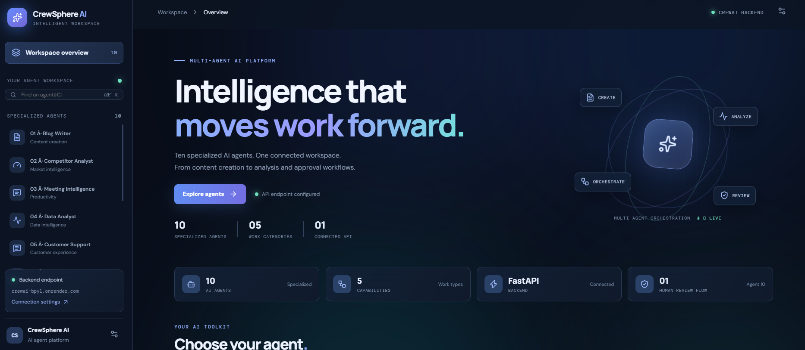
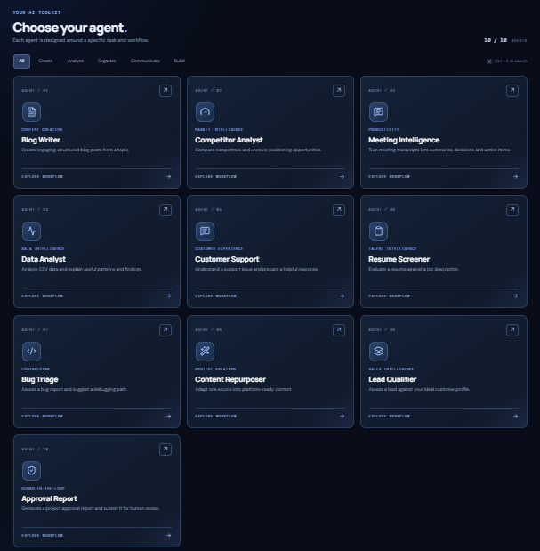
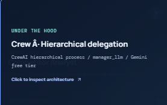
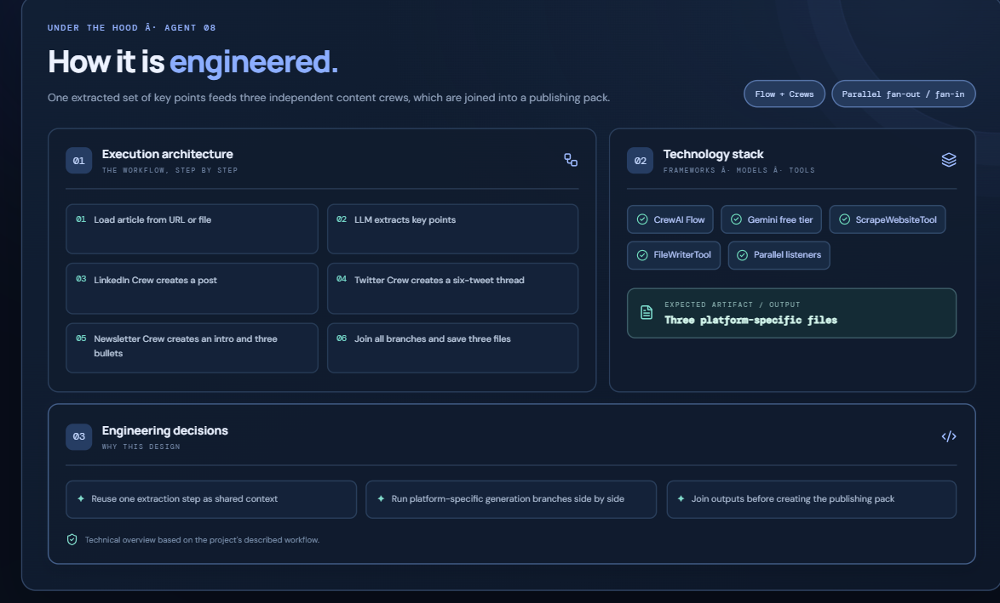
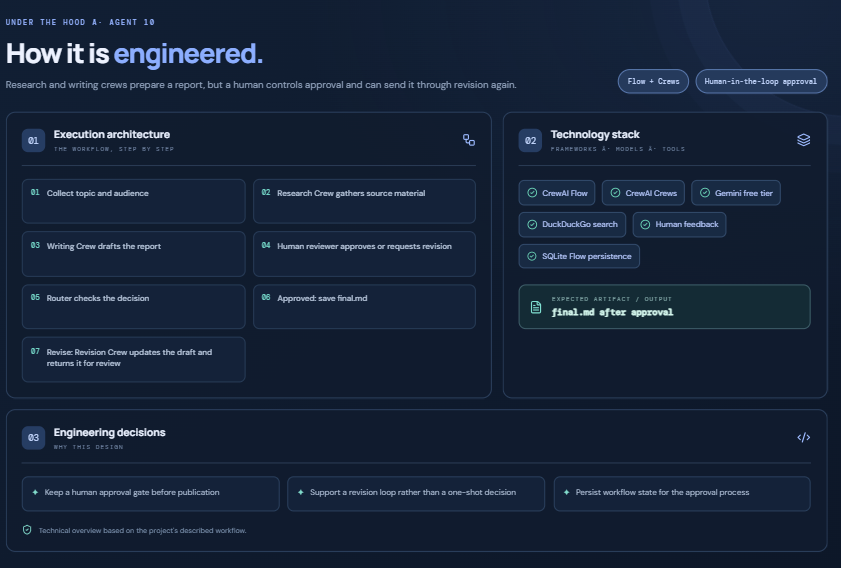

# CrewSphere AI

**A multi-agent AI platform powered by CrewAI, Google Gemini, FastAPI, and React.**

CrewSphere AI brings together ten focused AI agents behind a single web interface. Users can select an agent, submit a task, and view its generated result. The platform also includes an approval workflow for human review of generated reports.

> **Project:** CrewSphere AI  
> **Frontend:** https://crew-sphere.vercel.app/  
> **Backend API:** https://crewsphere-ai-backend-v2.onrender.com  
> **API health check:** https://crewsphere-ai-backend-v2.onrender.com/health

---

## Screenshots

### Dashboard


### Agent catalog


### Agent detail


### Parallel workflow


### Human approval


---

## Overview

CrewSphere AI is designed to make multiple specialized AI workflows accessible through one application. Each agent handles a different task, while the backend exposes API endpoints that the frontend can call.

### Key features

- Ten specialized AI agents available through one interface.
- React-based frontend for selecting agents and submitting requests.
- FastAPI backend with individual agent endpoints.
- Google Gemini integration for language-model-powered tasks.
- Human-in-the-loop review workflow for the Approval Report agent.
- API-based frontend/backend separation.
- Deployed frontend and backend.

---

## AI agent catalog

| # | Agent | Endpoint | Purpose |
|---:|---|---|---|
| 1 | Blog Post Generation | `POST /agent1` | Generates blog content from a user-provided brief. |
| 2 | Competitor Analysis | `POST /agent2` | Analyzes competitor-related information and produces insights. |
| 3 | Meeting Notes | `POST /agent3` | Converts meeting input into organized notes and action items. |
| 4 | Data Report | `POST /agent4` | Produces a structured report from supplied data or instructions. |
| 5 | Customer Support | `POST /agent5` | Generates responses for customer-support scenarios. |
| 6 | Resume Screening | `POST /agent6` | Assists with reviewing resumes against supplied criteria. |
| 7 | Bug Triage | `POST /agent7` | Helps classify and prioritize reported software bugs. |
| 8 | Content Repurposing | `POST /agent8` | Repurposes source content for different content formats or platforms. |
| 9 | Lead Qualification | `POST /agent9` | Evaluates lead information against qualification criteria. |
| 10 | Approval Report | `POST /agent10` | Creates a report draft and supports a human review step. |

Agent outputs depend on the information supplied in each request. Review generated content before using it for consequential decisions.

---

## Human-in-the-loop approval

The Approval Report agent supports a review process rather than treating the first generated draft as automatically final.

1. Submit a request to `POST /agent10` to generate an approval-report draft.
2. Review the generated draft and retain its `draft_id`.
3. Submit the review decision and feedback to `POST /agent10/review`.
4. The backend resumes the pending workflow and returns the resulting status or report.

The review endpoint accepts a JSON body using the application's review request contract. For example:

```json
{
  "draft_id": "YOUR_DRAFT_ID",
  "feedback": "APPROVE"
}
```

Use the actual `draft_id` returned by the draft-generation request. The example above is illustrative, not a real ID.

---

## Architecture

```text
                 ┌──────────────────────────┐
                 │       React UI           │
                 │   Deployed on Vercel     │
                 └────────────┬─────────────┘
                              │ HTTP requests
                              ▼
                 ┌──────────────────────────┐
                 │       FastAPI            │
                 │   Deployed on Render     │
                 └────────────┬─────────────┘
                              │
             ┌────────────────┼────────────────┐
             ▼                ▼                ▼
        Agent 1–3         Agent 4–7         Agent 8–10
             │                │                │
             └────────────────┼────────────────┘
                              ▼
                    Google Gemini / LLM
```

The frontend communicates with the backend through HTTP API requests. The backend routes each request to the corresponding agent workflow.

---

## Technology stack

| Layer | Technologies |
|---|---|
| Frontend | React, JavaScript, Vite |
| Backend | Python, FastAPI |
| Agent framework | CrewAI |
| LLM integration | Google Gemini |
| API validation | Pydantic |
| Frontend hosting | Vercel |
| Backend hosting | Render |
| API testing | Postman |

---

## API

### Base URL

```text
https://crewsphere-ai-backend-v2.onrender.com
```

### Agent endpoints

```text
POST /agent1
POST /agent2
POST /agent3
POST /agent4
POST /agent5
POST /agent6
POST /agent7
POST /agent8
POST /agent9
POST /agent10
POST /agent10/review
```

### Request format

Agent task endpoints use a JSON request body in this format:

```json
{
  "input": "Enter your task or instructions here."
}
```

The standard task response uses an `output` field:

```json
{
  "output": "Generated result appears here."
}
```

The Approval Report review endpoint uses its review-specific request body, shown in the Human-in-the-loop section.

### Interactive API documentation

When the backend is awake, FastAPI's interactive API documentation is available at:

- Swagger UI: `https://crewsphere-ai-backend-v2.onrender.com/docs`
- OpenAPI schema: `https://crewsphere-ai-backend-v2.onrender.com/openapi.json`

---

## Run locally

### Prerequisites

- Python
- Node.js and npm
- A Google Gemini API key

### 1. Clone the repository

```bash
git clone https://github.com/akanksha-shree/CrewSphere.git
cd CrewSphere
```

### 2. Configure the backend

Create and activate a virtual environment from the project root (Windows PowerShell):

```powershell
python -m venv .venv
.\.venv\Scripts\Activate.ps1
```

Install the backend dependencies using the requirements file in the backend project, if present:

```powershell
pip install -r .\backend\requirements.txt
```

Create or update the backend environment file used by the application and add your Gemini API key:

```env
GEMINI_API_KEY=your_gemini_api_key
```

Do not commit `.env` files or API keys to GitHub.

Start the FastAPI application from the project root:

```powershell
uvicorn backend.app:app --reload
```

If your local project uses a different ASGI module path or requirements-file location, use the path configured in that checkout.

### 3. Configure the frontend

Open a second terminal:

```powershell
cd .\frontend
npm install
npm run dev
```

Vite will print the local frontend address in the terminal.

---

## Deployment

| Component | Platform | URL |
|---|---|---|
| Frontend | Vercel | https://crew-sphere.vercel.app/ |
| Backend | Render | https://crewsphere-ai-backend-v2.onrender.com |

The backend is hosted on Render's free instance. It may spin down after inactivity, so the first request after a period of inactivity can take longer while the service starts.

---

## Repository layout

The following is a high-level view of the project. Exact module names may differ as the implementation evolves.

```text
CrewSphere/
├── backend/
│   └── app.py
├── frontend/
│   └── src/
│       └── App.jsx
├── docs/
│   └── screenshots/
│       ├── 01-dashboard.png
│       ├── 02-agent-catalog.png
│       ├── 03-agent-detail.png
│       ├── 04-parallel-workflow.png
│       └── 05-human-approval.png
└── README.md
```

---

## Testing

The API can be tested using Postman or the interactive Swagger UI.

For each agent endpoint:

1. Set the method to `POST`.
2. Use the corresponding endpoint from the API section.
3. Select **Body → raw → JSON**.
4. Send a valid JSON request using the expected request schema.
5. Inspect the response and verify the generated output.

For the Approval Report workflow, test both draft generation (`POST /agent10`) and review (`POST /agent10/review`) using the `draft_id` returned by the first request.

---

## Security notes

- Keep API keys in environment variables.
- Never commit `.env` files, credentials, or private tokens.
- Do not place secrets in frontend source code.
- Treat AI-generated content as a draft and verify it before relying on it.

---

## Future improvements

- Add richer execution and progress states for agent workflows.
- Expand automated tests for each agent and review path.
- Improve error handling and user-facing recovery messages.
- Add persistent history and export options where appropriate.
- Add monitoring for deployed API availability and latency.

---

## Author

**Akanksha Shree**

GitHub: https://github.com/akanksha-shree

---

*CrewSphere AI — one interface, ten specialized AI agents, and human review where it matters.*
